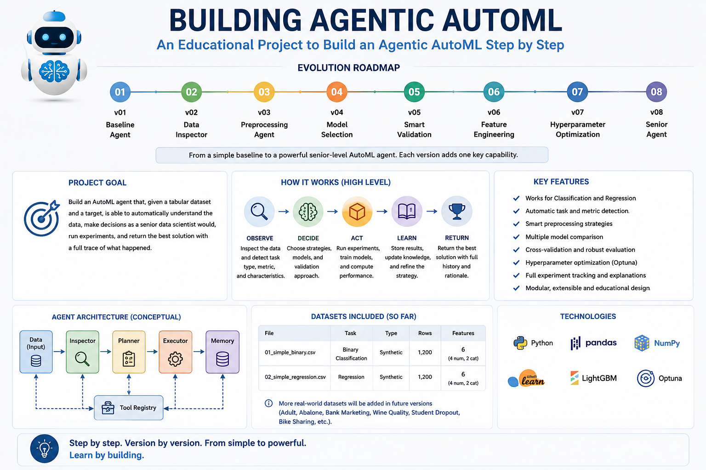

# Building Agentic AutoML

A progressive educational project that shows how to build an **Agentic AutoML system step by step**, starting from a minimal baseline agent and gradually evolving toward a more autonomous machine learning workflow.

The project focuses on understanding how an AutoML agent can inspect tabular data, make modeling decisions, prepare features, select an appropriate model and metric, train and evaluate the model, and return the complete result as a structured state.

The architecture intentionally starts simple. Each version introduces one new concept while preserving the ideas developed in the previous versions.

Version 8 completes the original roadmap with **Autonomous Experiment Planning**. The project now moves from exhaustive AutoML search to a first adaptive, transparent and budget-aware Senior Agent that decides which experiments are worth executing.

  [](LICENSE) [](https://www.kaggle.com/code/lucalullo/building-agentic-automl)

[Kaggle notebook](https://www.kaggle.com/code/lucalullo/building-agentic-automl) · [GitHub repository](https://github.com/lucalullo/building-agentic-automl) · [Technical report](project-report-en.pdf)



## Overview

The project follows one main principle:

> **One version, one concept, one architectural improvement.**

Version 1 establishes the fundamental AutoML workflow:

1. receive a dataset and target;
2. detect the machine learning task;
3. identify feature types;
4. prepare the data;
5. select a baseline model;
6. select an evaluation metric;
7. train and evaluate the model;
8. return a structured state.

Version 2 extends this baseline with a dedicated **Data Inspector**:

1. inspect dataset dimensions;
2. inspect target distribution or summary statistics;
3. inspect feature data types;
4. detect missing values;
5. measure feature cardinality;
6. store the inspection inside the agent state.

## Current capabilities

- load a tabular CSV dataset;
- receive the target column from the user;
- detect binary classification, multiclass classification and regression;
- identify numerical features automatically;
- identify categorical features automatically;
- inspect dataset dimensions;
- inspect target distribution for classification tasks;
- inspect target summary statistics for regression tasks;
- inspect feature data types;
- detect missing values and missing-value percentages;
- measure feature cardinality;
- detect duplicate rows;

## Architecture

```text
Dataset + Target
       ↓
  Task Detection
binary / multiclass / regression
       ↓
 Feature Detection
       ↓
 Data Inspection
       ↓
   Prepare X / y
       ↓
Build Candidate Experiment Space
24 available configurations
       ↓
Select Metric + Validation
       ↓
Senior Agent Planner
       ↓
Choose Next Experiment + Reason
       ↓
Preprocess Inside Each Fold
       ↓
Engineer Features Inside Each Fold
       ↓
Create Fresh Model with Parameters
       ↓
Cross-Validate Selected Experiment
       ↓
Record Score / Std / Time / Status
       ↓
Update Decision History + Current Best
       ↓
Budget Remaining?
   ↙         ↘
 yes         no
  ↓           ↓
plan next   return state
experiment  + best observed configuration
```

The architecture remains intentionally compact and rule-based.

The `agent()` function coordinates the complete workflow, while the **Senior Agent** introduced in Version 8 decides which experiment should be executed next.

The available experiment space is unchanged from Version 7:

Version 8 separates **what can be tested** from **what is actually executed**.

With the default budget:

With 5-fold cross-validation, this means at most:

instead of the 120 fits required by the exhaustive Version 7 search.

## Version guide

| Version | Focus | Notebook and resources |
|---:|---|---|
| 1 | Baseline Agent | [`v1-baseline-agent/`](v1-baseline-agent/) |
| 2 | Data Inspector | [`v2-data-inspector/`](v2-data-inspector/) |
| 3 | Preprocessing Agent | [`v3-preprocessing-agent/`](v3-preprocessing-agent/) |
| 4 | Model Selection | [`v4-model-selection/`](v4-model-selection/) |
| 5 | Smart Validation | [`v5-smart-validation/`](v5-smart-validation/) |
| 6 | Feature Engineering | [`v6-feature-engineering/`](v6-feature-engineering/) |
| 7 | Hyperparameter Optimization | [`v7-hyperparameter-optimization/`](v7-hyperparameter-optimization/) |
| 8 | Autonomous Experiment Planning | [`v8-senior-agent/`](v8-senior-agent/) |

### What each version introduces

<details>
<summary>Version 1 - Baseline Agent</summary>

The first version introduces the complete baseline AutoML flow:

The objective is not yet to create a complete production AutoML platform.

</details>

<details>
<summary>Version 2 - Data Inspector</summary>

Version 2 introduces the first new capability on top of the baseline agent: **dataset inspection before training**.

The objective is to make the agent more informed without changing the baseline modeling strategy introduced in Version 1.

</details>

<details>
<summary>Version 3 - Preprocessing Agent</summary>

Version 3 introduces the next capability on top of the Data Inspector: **preprocessing experimentation before training**.

The objective is to let the agent test simple preparation choices while keeping the model family and validation strategy unchanged.

</details>

<details>
<summary>Version 4 - Model Selection</summary>

Version 4 introduces the next capability on top of preprocessing experimentation: **automatic model comparison**.

The objective is to let the agent choose among multiple strong model candidates while keeping preprocessing and validation unchanged.

</details>

<details>
<summary>Version 5 - Smart Validation</summary>

Version 5 introduces the next capability on top of model selection: **task-aware cross-validation**.

The objective is to make model selection more reliable by replacing the single train-validation split with a more robust validation strategy, while keeping preprocessing and model candidates unchanged.

</details>

<details>
<summary>Version 6 - Feature Engineering</summary>

Version 6 introduces the next capability on top of smart validation: **automatic feature engineering**.

The objective is to let the agent compare alternative feature spaces while keeping preprocessing, model candidates, metrics, validation and hyperparameter configurations unchanged.

</details>

<details>
<summary>Version 7 - Hyperparameter Optimization</summary>

Version 7 introduces the next capability on top of feature engineering: **automatic comparison of hyperparameter configurations**.

The objective is to let the agent compare model configurations while keeping task detection, data inspection, preprocessing, feature engineering, model families, metrics and validation unchanged.

</details>

<details>
<summary>Version 8 - Autonomous Experiment Planning</summary>

Version 8 introduces the final capability in the original roadmap: a **Senior Agent** responsible for autonomous experiment planning.

The objective is no longer to evaluate the complete search space exhaustively.

</details>

## Getting started

### Requirements

- Python 3
- Jupyter Notebook or JupyterLab
- pandas
- LightGBM
- XGBoost
- CatBoost
- scikit-learn

Install the main dependencies:

```bash
pip install pandas lightgbm xgboost catboost scikit-learn jupyter
```

Clone the repository:

```bash
git clone https://github.com/lucalullo/building-agentic-automl.git
cd building-agentic-automl
```

Start Jupyter Notebook:

```bash
jupyter notebook
```

Then open the version you want to study:

```text
v01-baseline-agent/building-agentic-automl.ipynb
v02-data-inspector/building-agentic-automl.ipynb
v03-preprocessing-agent/building-agentic-automl.ipynb
v04-model-selection/building-agentic-automl.ipynb
v05-smart-validation/building-agentic-automl.ipynb
v06-feature-engineering/building-agentic-automl.ipynb
v07-hyperparameter-optimization/building-agentic-automl.ipynb
v08-senior-agent/building-agentic-automl.ipynb
```

and run the cells in order.

When running locally, update the dataset paths used inside the notebooks so they point to the local CSV files.

## Repository structure

Each version is kept in its own folder with the corresponding notebook and, where available, version-specific diagrams and reports.

## Documentation

- [Project report (English)](project-report-en.pdf)
- [Relazione del progetto (Italiano)](project-report-it.pdf)
- [Project infographic](infographic.png)

## Limitations

- task detection remains heuristic for discrete numerical targets;
- dataset inspection records several signals, but the current planning policy uses missing-value information directly while the remaining signals are primarily contextual;
- only two preprocessing strategies are available: native missing-value handling and simple imputation;
- numerical imputation uses only the median;
- categorical imputation uses only the most frequent value;
- there is no scaling or comparison of encoding strategies;
- there is no dedicated outlier detection or treatment;
- feature engineering is limited to pairwise multiplication between numerical features;
- there are no ratio, logarithmic, polynomial, datetime or categorical interaction strategies;

## Project status

**Version 1 - Baseline Agent is completed.**

**Version 2 - Data Inspector is completed.**

**Version 3 - Preprocessing Agent is completed.**

**Version 4 - Model Selection is completed.**

**Version 5 - Smart Validation is completed.**

**Version 6 - Feature Engineering is completed.**

**Version 7 - Hyperparameter Optimization is completed.**

**Version 8 - Autonomous Experiment Planning is completed.**

## License

Distributed under the [MIT License](LICENSE).

## Author

Created by [Luca Lullo](https://github.com/lucalullo).
